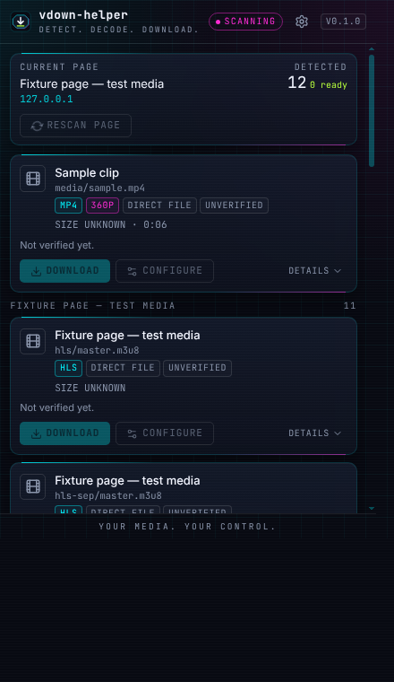
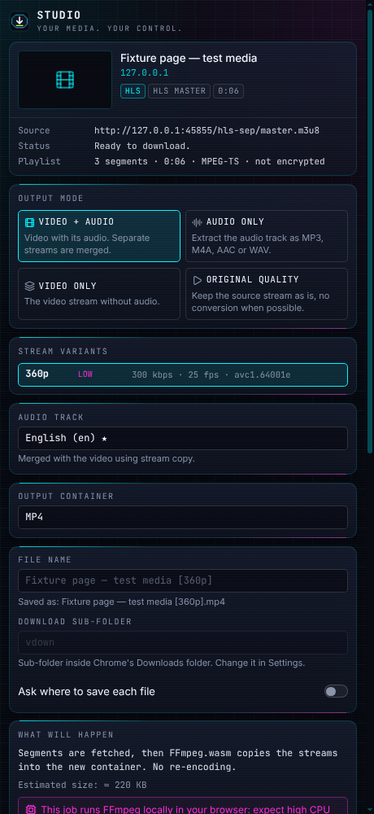

# vdown-helper

**Detect. Decode. Download.** · _YOUR MEDIA. YOUR CONTROL._

A Chrome (Manifest V3) extension that finds video, audio and files on the page you are viewing (including inside
nested, cross-origin iframes), shows what can really be saved, and saves it locally: direct files through Chrome's
download manager, HLS and MPEG-DASH streams by fetching and joining segments, players that feed the video through
Media Source Extensions by capturing what they play, camera / screen / call streams and live streams by recording
them, plus subtitles, images, documents and archives, with optional merging and audio extraction in a bundled
FFmpeg.wasm. Everything runs on your machine; no URL or browsing data is ever sent to a server.

| Popup                                         | Studio (side panel)                          |
| --------------------------------------------- | -------------------------------------------- |
|  |  |

It only downloads what the page already serves you and what you are allowed to save. It **does not** bypass DRM,
logins, paywalls or any other protection (see [Limitations](#limitations-read-this)).

---

## Contents

1. [Quick start](#quick-start)
2. [How to use it](#how-to-use-it)
3. [Implemented vs unsupported](#implemented-vs-unsupported)
4. [Output modes: copy vs transcode](#output-modes-copy-vs-transcode)
5. [Permissions](#permissions)
6. [Limitations (read this)](#limitations-read-this)
7. [Architecture](#architecture)
8. [Development and tests](#development-and-tests)
9. [Manual test procedure](#manual-test-procedure)
10. [Troubleshooting](#troubleshooting)
11. [Security and privacy](#security-and-privacy)
12. [Licence](#licence)

---

## Quick start

Requirements: Node.js **22.18+** (the build loads TypeScript config natively), npm, Google Chrome 116+.

```bash
npm install
npm run build          # produces dist/
npm run check:dist     # validates manifest, assets, locales, CSP, no remote code
```

Install in Chrome:

1. Open `chrome://extensions` and switch on **Developer mode**.
2. **Load unpacked** → choose the `dist/` folder.
3. Pin the extension, open a page that plays video, and click the icon.

`npm run build` also copies the FFmpeg.wasm core (≈ 31 MB) from `node_modules` into `dist/vendor/ffmpeg/`. It is
bundled with the extension and never downloaded at runtime.

## Releases and the Chrome package

`npm run package` builds the extension, runs the `dist/` checks and writes `release/vdown-helper-<version>.zip`
(+ a `.sha256`). `manifest.json` is at the root of the zip, source maps are excluded and the archive is reproducible:
the same commit gives the same SHA-256.

The **Release** workflow (`.github/workflows/release.yml`) runs on every push to `main` that changes more than docs
(`*.md`, `BACKLOG/`, `docs/` and `.claude/` are ignored): typecheck, lint, format, unit tests, build, `check:dist`,
package, then it uploads the zip as a build artifact, tags the commit `v<version>` and publishes a GitHub Release
with the zip and checksum attached. A re-run on a commit that already has a release tag publishes nothing new.

**The version is bumped automatically** (`scripts/next-version.mjs`):

| Situation                                                                                                              | Version                                                                  |
| ---------------------------------------------------------------------------------------------------------------------- | ------------------------------------------------------------------------ |
| No release yet                                                                                                         | the version in `package.json` (first release: `0.1.0`)                   |
| Normal push to `main`                                                                                                  | latest `v*` tag + **patch** (`0.1.0` → `0.1.1`)                          |
| `#minor` or `#major` on a line of its own, or `[minor]` / `[major]` in the subject, of a commit since the last release | minor (`0.1.5` → `0.2.0`) / major (`0.2.0` → `1.0.0`)                    |
| _Run workflow_ by hand                                                                                                 | choose `auto`, `patch`, `minor` or `major`                               |
| `package.json` is ahead of the result                                                                                  | `package.json` wins, so you can still jump to e.g. `1.0.0` by editing it |

Nothing is committed back to `main`: the released version lives in the tag, the zip name and the manifest inside the
zip (`VDH_VERSION` is injected at build time), so `package.json` keeps the _first/base_ version and a local
`npm run package` produces that base version.

Install a release: download `vdown-helper-<version>.zip`, unzip it, open `chrome://extensions`, enable _Developer
mode_, **Load unpacked** and pick the unzipped folder. The same zip is what the Chrome Web Store accepts for upload
(the store review and listing are separate steps this repository does not automate). A signed `.crx` is not built:
that needs a private signing key that must not live in the repo.

## How to use it

1. **Open the popup** on a page. It scans automatically (`SCANNING` → `READY`); `RESCAN PAGE` scans again, for example
   after you press play. When the page has more than one kind of thing, the popup shows **tabs with counts**: Video,
   Audio, Subtitles, Images, Files and Assets. Items are grouped by the frame they were found in ("This page",
   "Embedded: host").
2. Each **card** shows the format, resolution, size (or `SIZE UNKNOWN`), duration, number of variants, and a status:
   `DOWNLOADABLE`, `PROTECTED`, `INACCESSIBLE`, `UNSUPPORTED` or `UNVERIFIED`, with the reason under `DETAILS`.
3. **`DOWNLOAD`** queues the item with your defaults (Settings). **`CONFIGURE`** opens the **Studio** side panel:
   choose output mode, stream variant, audio track, container/format, file name and "ask where to save", read what
   will happen (direct / join / FFmpeg copy / transcode), then press **START DOWNLOAD**. Nothing ever starts without
   a button press.
4. Some things are not downloads, so their card has other buttons:
   - **`CAPTURE (FAST)` / `RECORD (REAL TIME)`** — a player that feeds the video piece by piece (MSE, a `blob:` URL
     with no file behind it). Needs _Look inside players_ (on by default) and access to the site. The page plays the video through (muted, at up to
     16×, or in real time) while the extension records what the player receives. A banner on the page says so and has
     **Cancel**; the video is put back as it was.
   - **`RECORD`** on a **live or event stream** (HLS / DASH) or on a **camera, screen share, call or canvas stream**.
     The queue shows `RECORDING` with elapsed time and size; **Stop and save** keeps what was recorded, **Cancel**
     discards it. A recording also stops by itself (and is saved) at the limits in _Settings → Recording_
     (default 120 minutes / 4096 MB).
   - **Images, documents, archives and page assets** have checkboxes, filters and **Download as ZIP**.
5. The **queue** shows stages (`DETECTED → PREPARING → DOWNLOADING → MERGING/ENCODING → COMPLETED`, or
   `… → RECORDING → MERGING → …`; only the stages a job really uses), real progress, speed and ETA when measurable,
   and pause / resume (native downloads only), cancel, retry, open and show-in-folder.
6. If a card says **INACCESSIBLE · cross-origin**, `ALLOW SITE ACCESS` asks Chrome for access to _that one site_ and
   rescans. If a page embeds players from other sites, the popup lists those sites and **`ALLOW ALL EMBEDDED PLAYERS`**
   asks Chrome **once** for access to all sites: from then on every embedded player on every site, nested to any depth,
   is read without asking again (also in _Settings → Allow all sites and embedded players_; revocable there). With
   _Look inside players_ on, the popup then offers `RELOAD PAGE` so the hook sees the players from the start.
7. **Settings** (gear icon): default mode, quality preset, audio format and bitrate, naming template, sub-folder,
   concurrency, memory/encode limits, recording format and limits, _Look inside players_, notifications, auto-scan,
   network observer, clear history, reset.

The UI is available in English and Italian (follows Chrome's UI language).

## Implemented vs unsupported

"Verified" means exercised by the automated tests described in [Development and tests](#development-and-tests)
(real Chromium, real files decoded by `ffmpeg`). The right-hand column is the honest list of what is **not** done.

| Area                       | Implemented and verified                                                                                                                                                                                                                    | Not supported / not verified                                                                                                                                                      |
| -------------------------- | ------------------------------------------------------------------------------------------------------------------------------------------------------------------------------------------------------------------------------------------- | --------------------------------------------------------------------------------------------------------------------------------------------------------------------------------- |
| Where it looks             | `<video>`/`<audio>`, `<source>`, `<track>`, links, Performance timeline, open shadow roots, **every frame including nested cross-origin iframes** (per-site access, or one grant for all sites), optional `webRequest` observer             | Closed shadow roots; frames of origins you did not allow; sites that check anything beyond the Referer/Origin the browser itself sent                                             |
| Page hook (on by default)  | _Look inside players_: sees manifests a player loads by script, EME use, and which MediaSource a `blob:` URL stands for                                                                                                                     | Runs only on sites you allowed; can be turned off                                                                                                                                 |
| Direct files               | MP4, WebM, MKV, MOV, OGV, FLV, AVI, WMV, ASF, 3GP, MPG, MP3, M4A, AAC, WAV, OGG, Opus, FLAC, AIFF, WMA via Chrome's download manager; the browser-sent Referer/Origin is replayed when a host demands it (then via the extension)           | Headers other than Referer/Origin, cookies for hosts you did not allow                                                                                                            |
| HLS                        | master and media playlists, audio renditions, fMP4 and TS, byte ranges, **AES-128**, VOD download, join without re-encoding                                                                                                                 | **SAMPLE-AES** and every DRM (refused), I-frame-only streams                                                                                                                      |
| MPEG-DASH                  | static and dynamic manifests, `SegmentTemplate` (number, time, timeline), `SegmentList`, multi-period (longest period), separate audio, text tracks, `ContentProtection` classified                                                         | Encrypted DASH of any kind (Widevine, PlayReady, FairPlay refused; **ClearKey is detected, not decrypted** — VDH-045), `SegmentBase` + `sidx` indexing                            |
| Subtitles                  | `<track>`, WebVTT / SRT / TTML files, HLS WebVTT and DASH text segments stitched; saved as found or converted to SRT                                                                                                                        | Image-based subtitles, WebVTT-in-MP4 cues                                                                                                                                         |
| `blob:` and `data:`        | A real Blob or a `data:` URL is read **inside the page that owns it** and handed over (4 GiB / 32 MB); `blob:` is never fetched by the extension                                                                                            | A `blob:` URL revoked before the scan                                                                                                                                             |
| MSE players                | When the player's own manifest is found it is downloaded normally; otherwise **capture**: the page plays through, the extension records what is appended, and copies it into MP4 / WebM / MKV (a quality switch gives one file per quality) | EME-protected playback (refused), live MediaSources, more than the quality the player chose, H.264/AAC capture is covered by parser tests but not by a real player                |
| MediaStream                | Camera, screen share, WebRTC and canvas streams shown by a `<video>`/`<audio>`: recorded with `MediaRecorder` until Stop or a limit, WebM (MP4 where Chrome records it)                                                                     | The MP4 recording path is not verified (no H.264 encoder in the test browser); audio-only streams are saved as WebM/M4A, not converted                                            |
| Live / event streams       | HLS live and event playlists and DASH dynamic manifests: followed from now on, each new segment saved as it appears, until Stop, the end of the stream or a limit; gaps counted and reported; separate audio kept in sync                   | DRM; real third-party live sites were not tried; a gap leaves a hole in the timeline                                                                                              |
| Images, files, assets      | Images (with size filter), documents, archives and page assets; per-type tabs; **ZIP** (classic ZIP, bounded by the memory limit)                                                                                                           | ZIP64, folders, streams from `<canvas>`                                                                                                                                           |
| Page metadata / open sites | Open Graph, JSON-LD `contentUrl`, `<link rel=alternate>`, podcast feeds on the page's own origin; Wikimedia Commons, Internet Archive and PeerTube public APIs (asked on the page's own origin, anonymously)                                | oEmbed (third-party servers, returns embed HTML), any YouTube/Vimeo-style extractor — none exists and none will be added; Commons / Archive not tried on the real sites (VDH-046) |
| Processing                 | stream-copy remux, merge of separate video+audio, video-only, audio extract to **M4A/AAC (copy when AAC)**, **MP3/WAV (transcode)** at 128/192/256/320 kbps                                                                                 | Re-encoding **video** (never done), upscaling, hardware encoders, files larger than the memory limit                                                                              |
| UI                         | popup with tabs, Studio side panel, options, EN/IT, keyboard operable, reduced-motion aware                                                                                                                                                 | Thumbnails for streams (only a page-provided poster)                                                                                                                              |
| Safety                     | URL scheme allow-list, file-name sanitiser, no remote code, redacted logs, validated messages, least-privilege permissions, DRM refused in the UI and again in the background                                                               | —                                                                                                                                                                                 |
| Companion                  | architecture documented in [`docs/native-companion.md`](docs/native-companion.md)                                                                                                                                                           | **The companion app itself is not built**                                                                                                                                         |

## Output modes: copy vs transcode

The Studio says which of these will happen _before_ you start. Video is **never** re-encoded.

| You choose                                          | Source                     | What happens                                                                                     | Quality                       |
| --------------------------------------------------- | -------------------------- | ------------------------------------------------------------------------------------------------ | ----------------------------- |
| Original / Video+Audio, same container              | direct file                | Chrome downloads it as is                                                                        | identical                     |
| Original, HLS with muxed audio (TS or fMP4)         | HLS                        | segments are joined on disk, no FFmpeg                                                           | identical                     |
| MP4 / MKV container                                 | any with compatible codecs | FFmpeg.wasm **stream copy**                                                                      | identical                     |
| Video+Audio with a **separate audio rendition**     | HLS                        | FFmpeg.wasm **merge** (copy both)                                                                | identical                     |
| Video only                                          | any                        | FFmpeg.wasm copy without audio (native when already video-only)                                  | identical                     |
| Audio only → **M4A / AAC**                          | AAC audio                  | stream **copy** (no bitrate option shown)                                                        | identical                     |
| Audio only → **M4A / AAC**                          | other codec                | audio **transcode** to AAC at 128–320 kbps                                                       | re-encoded                    |
| Audio only → **MP3**                                | any                        | audio **transcode** (libmp3lame) at 128–320 kbps                                                 | re-encoded                    |
| Audio only → **WAV**                                | any                        | decode to PCM, no bitrate option                                                                 | lossless decode of the source |
| Container the codec cannot go into (e.g. VP8 → MP4) | —                          | **refused**: needs video re-encoding, which is not supported                                     | —                             |
| Capture of an MSE player                            | player feeds the video     | recorded segments are **copied** into MP4 / WebM / MKV                                           | identical to what was played  |
| Recording a camera / screen / call stream           | MediaStream                | the browser's `MediaRecorder` writes WebM (MP4); a copy tidies it                                | what the browser encoded      |
| Recording a live / event stream                     | HLS / DASH live            | segments appended as they appear, then copied into MP4 (or kept as TS when too large for memory) | identical                     |

Options that are not valid for the selected source are disabled, with the reason shown.

## Permissions

Installed with the extension:

| Permission                    | Why                                                                                                                                    |
| ----------------------------- | -------------------------------------------------------------------------------------------------------------------------------------- |
| `activeTab`                   | Temporary access to the tab you open the extension on, so the read-only scanner can run. No broad host access is requested at install. |
| `scripting`                   | Injects the scanner (`content.js`) on demand. It only reads; it never changes the page.                                                |
| `downloads`, `downloads.open` | Saves files with Chrome's download manager; opens / reveals a finished file.                                                           |
| `storage`                     | Settings, the download queue and per-tab scan results, on this device.                                                                 |
| `offscreen`                   | A hidden page that joins segments and runs FFmpeg.wasm (service workers cannot create blob URLs or spawn workers).                     |
| `notifications`               | Optional completion/failure notifications (file name only).                                                                            |
| `sidePanel`                   | The Studio panel.                                                                                                                      |

**Optional** (asked for only when you use the related feature, revocable in Settings):

| Permission                            | When                                                                                                                                                                                                                                                                                               |
| ------------------------------------- | -------------------------------------------------------------------------------------------------------------------------------------------------------------------------------------------------------------------------------------------------------------------------------------------------- |
| Access to a specific site             | When a stream's host does not allow cross-origin reads (`ALLOW SITE ACCESS`, or when starting an HLS/DASH download), Never "all sites" for this (see below).                                                                                                                                       |
| `declarativeNetRequestWithHostAccess` | Asked together with a site's access. Lets a download send the **Referer / Origin the browser itself sent** for that frame, for the length of that one job, because some hosts refuse a file without them. Nothing else is added.                                                                   |
| `webRequest` + all-sites access       | Only if you enable **Scan pages automatically** or **Observe media requests** in Settings. The observer reads response headers (never bodies); nothing is blocked or modified.                                                                                                                     |
| All-sites access                      | Only when you press `ALLOW ALL EMBEDDED PLAYERS` in the popup or switch on **Allow all sites and embedded players** in Settings: one prompt, then every frame of every site can be scanned without asking again. Revocable at any time.                                                            |
| Page hook (_Look inside players_)     | No permission of its own; on by default and registered only for the sites you allowed (one by one or all). A read-only script runs in their frames at document start, so that scripts' manifests, EME use and MediaSource buffers can be seen. It sends nothing anywhere; turn it off in Settings. |

Content-Security-Policy for extension pages: `script-src 'self' 'wasm-unsafe-eval'; object-src 'self'`.
`wasm-unsafe-eval` is required to instantiate FFmpeg.wasm; there is no `unsafe-eval`, no inline script and no remote
code (`npm run check:dist` enforces this).

## Limitations (read this)

- **Not every stream can be seen.** Chrome extensions cannot inspect every request or every player. Detection relies
  on what the page exposes (DOM, Performance timeline, every frame you allowed) plus, if you opt in, response headers
  via `webRequest` and the page hook. Closed shadow roots, frames of sites you did not allow and obfuscated players
  can still hide media.
- **Cross-origin rules (CORS).** The scanner reads with the page's own origin and cookies, exactly like the page's
  player. Downloading segments happens from the extension, which is subject to CORS unless you grant that site. A
  `403`/CORS failure is shown as such; it is never hidden or retried forever. Fetch failures cannot distinguish "CORS
  refused" from "network down" (a browser limitation), so the message says both.
- **Authenticated media.** Cookies are sent only to origins you granted (never to other hosts a playlist mentions —
  those are fetched anonymously). The only request header the extension replays is the **Referer / Origin the browser
  itself sent** for that frame. Streams that need custom headers, tokens injected by page scripts, or short-lived
  signed URLs may fail or expire between detection and download. Embed hosts that check more than that will fail, and
  say so. Nothing is written for any particular site and **no site-specific extractor exists**.
- **DRM.** Widevine, PlayReady, FairPlay, SAMPLE-AES, EME-protected playback (`mediaKeys`, `requestMediaKeySystemAccess`,
  `ContentProtection`) are **detected and refused** in the popup, in the Studio, and again in the background, for
  downloads, captures and recordings alike. There is no workaround and none is planned. Plain **AES-128** HLS (key
  fetchable by the page itself) is decrypted, as any player would; a DASH stream whose key is openly delivered
  (ClearKey) is detected and labelled but **not yet decrypted** (VDH-045).
- **Capture and recording.** A capture gets only the quality the player chose, needs the page to play (it is muted and
  put back afterwards), and splits into one file per quality if the player switches (never a re-encode). A
  recording of a MediaStream is what the browser's `MediaRecorder` encodes. Closing or leaving the tab keeps what had
  been recorded so far. Live recordings leave a visible hole (and a message) where the server had already dropped a
  segment.
- **Browser memory.** HLS/DASH joined as TS/fMP4 is staged on disk (OPFS), but FFmpeg.wasm holds its output in memory.
  The default cap is **2048 MB** (Settings); jobs estimated above it are refused with an explanation instead of
  crashing the tab. ZIP archives obey the same cap. wasm FFmpeg is single-threaded and slow: expect high CPU use on
  long videos.
- **Browser-managed downloads.** Chrome chooses the Downloads folder (you can add a sub-folder, or ask "Save as").
  Pause/resume exists only for native downloads; segment/FFmpeg jobs can be cancelled and retried but not paused.
  Chrome may reject unusual file names; the extension then retries with an ASCII-only name.
- **Native messaging.** Not used. A companion app for very large files is documented
  ([`docs/native-companion.md`](docs/native-companion.md)) but **not built**.
- **Estimated sizes** for HLS/DASH are `bandwidth × duration` and are always shown with `≈`.
- **Chrome Web Store.** A general-purpose downloader can be rejected under the store's policies. See
  [`docs/store-policy.md`](docs/store-policy.md) for the permission justifications and an honest risk assessment. The
  same zip can be installed from GitHub Releases.

## Architecture

```
manifest.json            MV3 manifest (version is injected from package.json at build time)
_locales/{en,it}         chrome.i18n catalogs (a test enforces identical keys and placeholders)
src/
  background/            service worker: detect.ts (scan of all frames, orchestration), pageFetch.ts (page-origin
                         fetch, capture/record calls via scripting), observer.ts (optional webRequest), hook.ts
                         hooks.ts (registers the page hook for allowed sites), replay.ts (Referer/Origin for one job), runner.ts (queue,
                         chrome.downloads, offscreen bridge, validation of every request), jobStore.ts, tabState.ts
  content/               scanner.ts (read-only page scanner, IIFE), metadata.ts (Open Graph, JSON-LD, feeds, open
                         sites), ingest.ts (hands page-held bytes over), capture.ts (MSE capture and MediaStream
                         recording, with the on-page banner), hook.ts (MAIN-world hook)
  offscreen/             hls.ts (segment engine, AES-128, OPFS), dash.ts, live.ts (live recording), capture.ts
                         (assembles captured parts), ingest.ts (receives bytes from a page over an acknowledged
                         port), subtitle.ts, zip.ts, ffmpeg.ts (FFmpeg.wasm), jobs.ts
  popup/ options/ sidepanel/   React UIs (sidepanel = "Studio"); popup has per-type tabs and frame groups
  components/ hooks/     shared UI and React hooks
  lib/                   pure logic: hls/ dash/ sites/ (parsers and adapters), analyze.ts, compat.ts (output
                         planner), request.ts, queue.ts (state machine), mse.ts + mseParts.ts (fMP4/WebM parsing),
                         metadata.ts, subtitles.ts, zip.ts, settings.ts, security.ts, messaging.ts ...
  types/ styles/         shared types; Tailwind theme (cyberpunk tokens, bundled fonts)
scripts/                 build.mjs, check-dist.mjs, make-icons.mjs, backlog.mjs, package.mjs, next-version.mjs
e2e/                     Playwright suite, fixture generator, local servers and test pages
BACKLOG/                 task files (status tracked per .claude/rules/backlog.md)
docs/                    native-companion.md, store-policy.md
```

Flow: popup → `scan` → service worker injects `content.js` in every frame it may enter → candidates (each knows its
frame) → each is probed _from its frame's origin_ (playlists parsed by `lib/hls`, `lib/dash`) → verdict
(`downloadable | protected | inaccessible | unsupported | unknown`) → stored per tab. `DOWNLOAD` / `CAPTURE` /
`RECORD` → `start-download` → the background **re-validates everything** against its own scan (a request names a
resource; URLs, frames, held bytes and ZIP contents are re-derived, never trusted) with the same planner
(`lib/compat.ts`) → queue → native `chrome.downloads`, or the offscreen document (segments → OPFS → optional
FFmpeg.wasm → blob URL → `chrome.downloads`).

Bytes that exist only in a page (`blob:`, `data:`, MSE appends, MediaRecorder output) never go through a URL the
extension fetches: the content script of the owning frame streams them to the offscreen document over a
`chrome.runtime` port, in acknowledged chunks, after the background has asked it to.

## Development and tests

```bash
npm run typecheck      # strict TypeScript
npm run lint           # ESLint (bans dangerouslySetInnerHTML, eval, any)
npm test               # Vitest: 600+ unit tests
npm run build && npm run check:dist   # also fails if test-only tooling or a Unicode noncharacter is in dist/
npm run test:e2e       # real Chromium + fixtures + ffprobe verification (needs ffmpeg/ffprobe on PATH)
E2E_ONLY='^live' npm run test:e2e     # only the steps whose name matches
npm run serve:fixtures # the E2E fixture sites, for manual testing
```

**Unit tests** cover HLS and DASH parsing (including dynamic manifests), subtitles, fMP4/WebM chunk parsing and part
splitting for captures, metadata and open-site parsers, file-name sanitising, queue state transitions (including
`recording` and Stop), the output planner, FFmpeg argument building, request validation, settings, message
validation, the content scanner (jsdom), the offscreen receivers of page-held bytes, live-recording rules (gaps,
limits, stalls) and i18n catalog parity.

**End-to-end tests** (`e2e/run.mjs`, about 110 steps) load the production build unpacked in Chromium and check real
files with `ffprobe`/`ffmpeg` (a full decode, not just a header probe): HLS (AES-128, fMP4, byte ranges, separate
audio), DASH, direct files and 9 more formats, subtitles, images / documents / ZIP, `blob:` and `data:` sources,
**genuine MediaSource playback** (a test player; the real **hls.js** and **dash.js** in cross-origin iframes),
fast and real-time capture, a quality switch splitting into parts, EME refusal, **MediaStream recording** (canvas +
tone; Stop from the queue and from the page; Cancel; closing the tab; the time limit), **live HLS and DASH
recording** (Stop, end of stream, a dropped segment, separate audio with a real offset, the limit, Cancel), Open
Graph / JSON-LD / podcast feeds, a PeerTube-shaped instance, nested cross-origin iframes (A → C → D), a
Referer-gated host, the page hook (registered only while enabled), pause/resume, cancel, retry, the memory guard,
DRM and unsafe-input refusal, restricted pages, keyboard order, the Italian UI, a forced service-worker shutdown,
**zero console errors in the service worker, offscreen document, popup, options and side panel**, and that no
request left the local origins.

What the automated run does **not** prove (verify manually, see [VDH-028](BACKLOG/VDH-028-manual-chrome-verification.md)):

- The browser's **permission prompts** for optional access cannot be clicked by automation. The E2E build is the
  production build plus `host_permissions` for the test sites and `webRequest`, which stand in for those grants.
- The real **toolbar popup** and `activeTab` grant (tests open the popup page in a tab and pass `?tabId=`) and
  `chrome.sidePanel.open()` from the popup (tests open the side-panel page directly).
- Branded **Google Chrome** (tests use Chromium for Testing, which has **no H.264/AAC**: MSE fixtures are VP9/Opus
  and the MP4 recording path of MediaStreams is untested) and non-Linux platforms.
- **Real sites and real third-party players.** Nothing here was tried on any live website; the open-site adapters
  for Wikimedia Commons and the Internet Archive were written from the public API documentation and tested on
  samples shaped like it (VDH-046).
- Very large files.

The E2E players (hls.js, dash.js) and Playwright are development dependencies; they are never in `dist/`
(`check:dist` asserts it) and their licences are listed in `THIRD_PARTY_NOTICES.md`.

## Manual test procedure

Start the fixture sites (`npm run serve:fixtures`) and load `dist/`. Open the printed _page_ URL, click the
toolbar icon.

1. **Direct MP4** — card "Sample clip", `DIRECT FILE`, real size. `DOWNLOAD` → completes; open the file; it plays,
   has audio. Pause/resume needs a download that lasts a few seconds: open `<site>/__slow/file.bin` (a throttled
   2 MB file) in a tab; it is also covered by the E2E suite.
2. **Accessible HLS** — `HLS MASTER` card (same-origin). `DOWNLOAD` → a `.ts` file that plays. In **Configure** choose
   MP4 → the summary says "FFmpeg.wasm copies the streams… No re-encoding" and `MERGING` appears in the queue.
3. **Multiple quality variants** — Studio lists exactly the variants in the playlist (360p and 180p for the fixture;
   never more). Pick 180p; the file's resolution is 320×180.
4. **Separate audio** — the `hls-sep` card: Studio shows an _Audio track_ picker; MP4 output needs the merge.
5. **Cross-origin failure** — the `closed/` CDN card shows `INACCESSIBLE`, the reason, and `ALLOW SITE ACCESS`
   (grant it in Chrome's prompt, the card rescans). The `open/` CDN card downloads without any prompt.
6. **Unsupported sources** — `PROTECTED` (SAMPLE-AES, Widevine in a DASH manifest), `UNSUPPORTED` (plain M3U,
   malformed DASH): `DOWNLOAD` is disabled and the reason is explained; Studio refuses to start. A **live** stream
   shows `RECORD`, not `DOWNLOAD`.
7. **Encryption** — the AES-128 card downloads and the video plays (a wrong key would produce garbage).
8. **Retry** — "flaky" playlist fails with `HTTP 404`; run `curl -X POST <site>/__flaky/enable`, press retry.
9. **Large download** — set _Memory limit_ to 128 MB in Settings, then convert anything ≥ 128 MB with MP4 → refused with
   the explanation; the same stream as TS/original still downloads (disk-backed). With a real multi-GB VOD, confirm the
   tab stays responsive and cancel works.
10. **Opt-in features** — enable _Scan pages automatically_: grant the prompt, reload a page, the icon shows a count.
    Enable _Observe media requests_, open `/pages/worker.html`: the worker's manifest appears with source "Network
    observer". _Revoke all-sites access_ removes both.
11. **Players inside players** — open the fixture page `/pages/frames-top.html` (nested cross-origin frames): the
    popup lists the other sites with `ALLOW ALL EMBEDDED PLAYERS`; one Chrome prompt for all sites, then the players
    (at every level) appear under "Embedded: host", and no other page asks again.
12. **Capture** — with _Look inside players_ on (the default) and the site allowed, open `/pages/mse.html` and reload:
    the card offers `CAPTURE (FAST)` and `RECORD (REAL TIME)`. The banner shows on the page, Cancel works, and the file
    plays.
13. **Recording** — open `/pages/stream.html` (a canvas + tone `MediaStream`): `RECORD`, wait a few seconds, then
    **Stop and save** in the queue (or Stop in the page banner). Try closing the tab while recording: the file keeps
    what was recorded. With a **webcam test page**, a **screen share** and a **call** page, with _Recording format_ set
    to MP4 and to WebM.
14. **Live** — open `/pages/live.html?src=hls/index.m3u8&id=a&len=60` (and `src=dash/manifest.mpd`): `RECORD`, **Stop
    and save**; the file plays. With `&len=7` it ends by itself; with `&gone=3` the queue reports one missing segment.
15. **Files** — `/pages/files.html`: the Images / Files / Assets tabs, the size filter, **Download as ZIP**.
16. **Open sites** — `/w/kkGMgK9ZtnKfYAgnEtQxbv` (PeerTube-shaped) and `/pages/meta.html` (Open Graph, JSON-LD, a
    podcast feed): the files are listed as "Page metadata" / "The site's public API". Then a **real** PeerTube
    instance, a Wikimedia Commons `File:` page and an Internet Archive `/details/` page.
17. **Keyboard** — Tab through popup/Studio/Settings: every control is reachable, has a visible focus ring, toggles and
    radios work with Space/Enter.

## Troubleshooting

| Symptom                                                | Cause / fix                                                                                                                                                                                                               |
| ------------------------------------------------------ | ------------------------------------------------------------------------------------------------------------------------------------------------------------------------------------------------------------------------- |
| "Chrome did not allow access to this tab"              | Browser pages, the Web Store and `file://` cannot be scanned. On a normal page, open the extension from the toolbar _on that page_ (grants `activeTab`).                                                                  |
| `NO MEDIA DETECTED` but a video plays                  | The player is in an iframe from another site (`ALLOW ALL EMBEDDED PLAYERS`), or feeds the video through MSE (_Look inside players_ needs the site allowed and a reload), or is protected. Press play, then `RESCAN PAGE`. |
| A card says it needs "Look inside players"             | The video is fed piece by piece (MSE). Allow the site (or all sites), keep that setting on, reload the page, rescan: the card then offers `CAPTURE`.                                                                      |
| A recording is shorter than expected                   | It stops at the limits in _Settings → Recording_, when the stream ends, or when the tab is closed or navigated away. What was recorded is always saved.                                                                   |
| `INACCESSIBLE · cross-origin`                          | The host blocks reads from other origins. Use `ALLOW SITE ACCESS`.                                                                                                                                                        |
| Job fails: "Blocked by the site's cross-origin policy" | Same cause at download time. Grant access and retry.                                                                                                                                                                      |
| Job fails with `HTTP 403/410`                          | Signed URLs usually expire. Rescan and start again; if the site needs special headers it is not supported.                                                                                                                |
| `PROTECTED`                                            | DRM or SAMPLE-AES. Not supported by design.                                                                                                                                                                               |
| "Estimated size exceeds your memory limit"             | Raise _Memory limit_ (Settings), or choose TS/Original (disk-backed).                                                                                                                                                     |
| Conversion is slow / fan spins                         | FFmpeg.wasm is single-threaded. Prefer stream-copy options (MP4/MKV) over audio re-encode on long videos.                                                                                                                 |
| File name looks different from the template            | Names are sanitised; characters Chrome rejects are folded to ASCII; Chrome adds `(1)` if the file exists.                                                                                                                 |
| Extension errors after update                          | `chrome://extensions` → reload the extension, then reload the page you want to scan.                                                                                                                                      |
| Need logs                                              | Service worker: `chrome://extensions` → _Inspect views_. Logs never contain query strings or credentials.                                                                                                                 |

## Security and privacy

- **Local only.** No analytics, no remote config, no remote code, no external requests (the E2E run asserts this).
- **Least privilege.** Nothing broad at install; per-site and all-sites access are optional and revocable.
- **Hostile input is assumed.** Page-derived strings are rendered as React text (never HTML); URL schemes are
  allow-listed (`http`/`https`); file names and sub-folders are sanitised twice (UI and background) against path
  traversal, reserved names and control/bidi characters; every message is validated and must come from this
  extension; the background re-checks DRM, live status and size limits no matter what the UI sent.
- **No confused deputy.** Extension-origin requests (the only ones exempt from CORS) never carry cookies to other
  sites, never target loopback / private-network / `.local` hosts on behalf of a public page, and are never made
  during an automatic scan. Responses are bounded in size, time and count, so a hostile playlist or server cannot
  exhaust memory, disk or a download slot.
- **Logs are redacted** (query strings and credentials removed from every logged URL).
- **Protected content stays protected.** DRM / SAMPLE-AES / EME-protected playback is refused in the UI _and_ in the
  background, for downloads, captures and recordings.
- **Page-held bytes stay in the page until you ask.** A `blob:` / `data:` source, a captured MSE buffer or a
  recording is read only by this extension's own content script in the frame that owns it, only after a request the
  background validated against its own scan, and travels over an acknowledged port (one claim per job, from that tab
  and frame, size-capped, ordered). The extension never fetches a `blob:` URL itself.
- **The page hook is read-only, on by default, and runs only on allowed sites.** It watches `fetch` / XHR / EME /
  MediaSource and sends nothing anywhere; the extension reads it on demand. It exists only while _Look inside players_
  is on and only for the sites you allowed (one by one, or all sites with one grant).
- You are responsible for having the right to save what you download.

## Licence

Application code: **MIT** (`LICENSE`). The bundled FFmpeg.wasm core is **GPL-2.0-or-later**; see
[`THIRD_PARTY_NOTICES.md`](THIRD_PARTY_NOTICES.md) before redistributing a package that contains it.

Project tracking lives in [`BACKLOG/`](BACKLOG/README.md).
